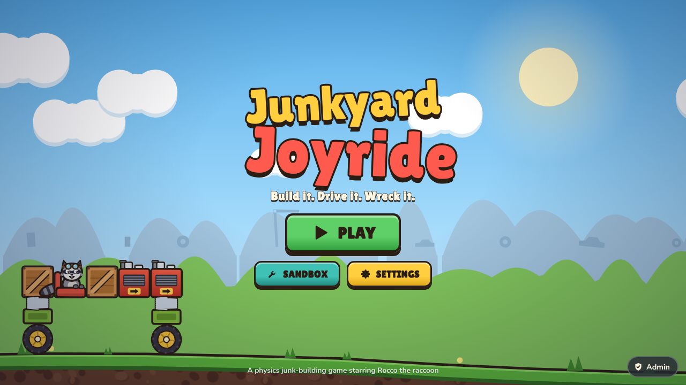
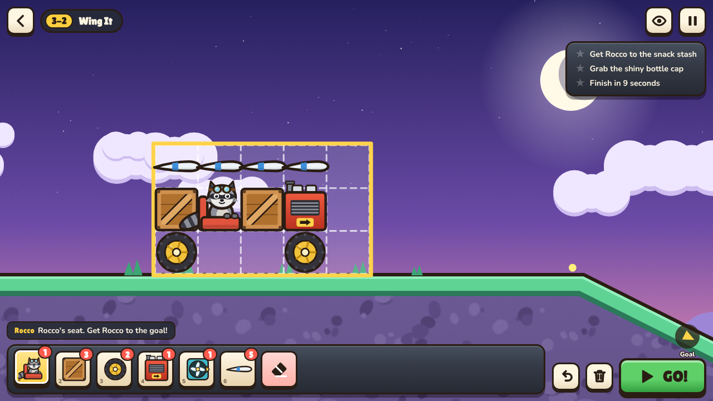
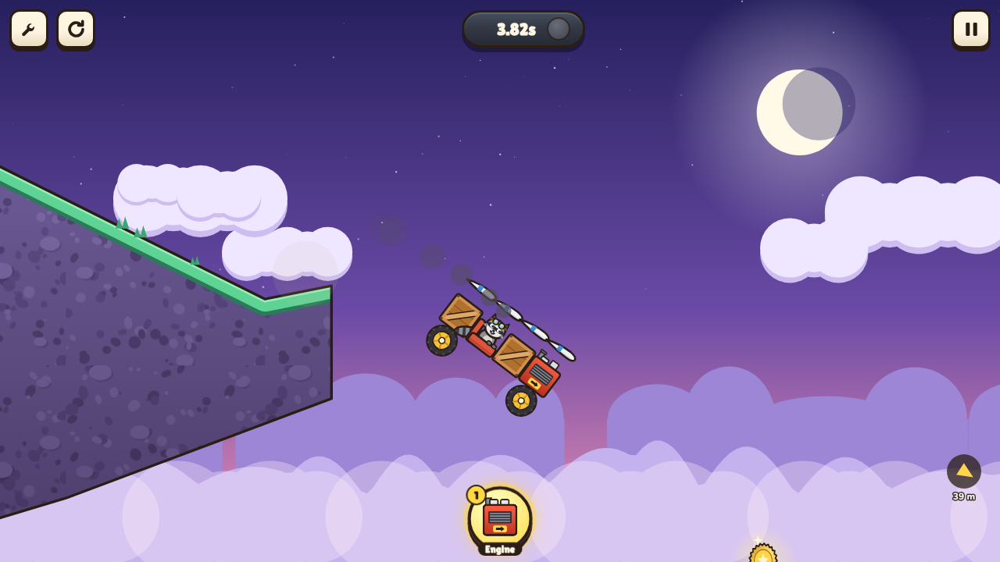
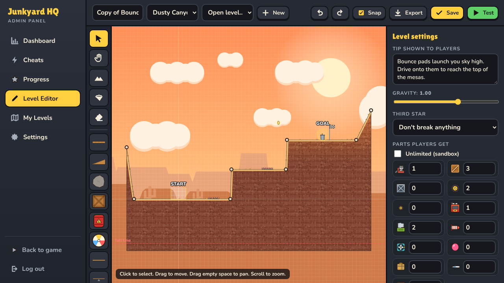

# Junkyard Joyride

Build wacky contraptions out of junk and get **Rocco the raccoon** to the snack stash!

A physics vehicle-building game that runs in any web browser. You build a ride on a grid out of crates, wheels, engines, rockets, balloons, parachutes, wings, springs and TNT, then press **Go** and hope it holds together.



| Build | Fly |
| --- | --- |
|  |  |

## What's inside

- **16 levels in 3 worlds** (Scrapyard Hills, Dusty Canyon, Sky Scraps) plus a **Sandbox** with unlimited parts.
- **13 parts**: Rocco's seat, wood crates, steel frames, wheels, small wheels, engines, springs, rockets, fans, balloons, parachutes, wings and TNT.
- **3 stars per level**: reach the goal, grab the shiny bottle cap, and beat a bonus challenge (time limit, no damage, fewer parts...).
- Real physics (planck.js): joints snap on hard crashes, TNT blows things apart, balloons pop on spikes, wings glide, parachutes ride updrafts.
- All art and sound are made in code, so there are no image or audio files to load.
- Works on phones and tablets (tap to build, tap the big buttons to fly).
- **Admin panel** with cheats, a progress editor, stats and a **level editor**.

Every built-in level is checked by `tools/test-levels.js`, which plays each one headlessly with a known contraption and confirms it can be beaten.

## Play it

Open `index.html` in a browser. That's it. No install, no build step.

### Controls

| Building | |
| --- | --- |
| Click / tap a part, then click the grid | Place it |
| Click a rocket, fan or engine again | Turn it |
| Right-click, or use the eraser | Remove a part |
| Drag outside the grid, mouse wheel | Look around and zoom |
| `1`-`9` | Pick a part |
| `Ctrl+Z` | Undo |
| `Space` / `Enter` | Go! |

| Driving | |
| --- | --- |
| Tap the round buttons, or `1`-`9` | Engines, rockets, fans, parachutes on/off, pop a balloon, boom! |
| Tap a part on your ride | Same as its button |
| `R` | Try again |
| `B` | Back to building |
| `P` / `Esc` | Pause |

## Put it on the internet (GitHub Pages)

1. Push this code to GitHub (it is already in this repo).
2. On GitHub, open the repo, then **Settings > Pages**.
3. Under **Build and deployment**, choose **Deploy from a branch**, pick your branch (for example `main`) and the **/ (root)** folder, then **Save**.
4. Wait a minute. Your game is live at `https://<your-username>.github.io/<repo-name>/`.

The admin panel is at `https://<your-username>.github.io/<repo-name>/admin.html` (or press **Admin** in the corner of the title screen).

## Admin panel



- **Passcode: `2001`.** To change it, go to **Admin > Settings**, type a new passcode and press **Make site code**. It gives you a line like `adminPassHash: '...'`. Paste it over the `adminPassHash` line in `js/config.js` and commit. The new passcode then works on your whole site.
- **Dashboard**: stars, levels beaten, runs, wins, explosions, balloons popped, play time.
- **Cheats**: god mode, unlimited parts, infinite fuel, unlock all levels, super grip, bouncy castle, big-head Rocco, rainbow trail, physics X-ray, and sliders for gravity, game speed, engine power, rocket power and balloon lift.
- **Progress**: tick boxes to set which levels are beaten and which stars are collected.
- **Level Editor**: draw ground and floating islands, place platforms, ramps, rocks, crates, TNT, balls, planks, seesaws, spikes, bounce pads, updrafts and barricades, move the start grid, goal and bottle cap, pick which parts players get and the bonus star rule, then press **Test** to play it right away.
- **My Levels**: play, edit, copy, export and import your levels.
- **Settings**: passcode, title-screen message, back up / restore save data, reset everything.
- While playing, press the shield button (or the `` ` `` key) for **quick admin tools**: drop crates and TNT from the sky, instant win, BOOM, slow motion and more.

> Heads up: this is a static website, so the passcode is a fun lock that keeps casual visitors out. It is not bank-level security. Cheats only change the game in the browser where you switch them on.

### Share your levels with everyone

Levels you make are saved in your browser. To put them on your site for every visitor:

1. **Admin > My Levels > Publish to your site**, then **Copy**.
2. Replace everything in `js/site-levels.js` with what you copied, and commit.
3. Your levels show up in a **Bonus** tab on the level select screen.

To show a message on everyone's title screen, set `motd` in `js/config.js`.

## Project layout

```
index.html          the game (the admin panel opens on top of it at index.html#admin)
admin.html          shortcut to the admin panel
css/game.css        game screens and buttons
css/admin.css       admin panel and level editor
js/config.js        site settings: admin passcode hash, title message
js/site-levels.js   extra levels for everyone (from the editor)
js/levels.js        the 16 built-in levels + sandbox
js/parts.js         the part list
js/sim.js           physics: building the contraption, joints, engines, rockets, explosions...
js/art.js           drawing Rocco, parts, props, goal and bottle cap
js/render.js        camera, backgrounds, terrain, particles
js/audio.js         sound effects and music, made with Web Audio
js/game.js          menus, build mode, play mode, results
js/admin.js         admin panel
js/editor.js        level editor
js/lib/planck.min.js  physics engine (planck.js, MIT license)
tools/              level checker (Node) and a level filming tool (Playwright)
```

### Checking the levels

With [Node.js](https://nodejs.org) installed:

```
node tools/test-levels.js          # play every level with a known solution
node tools/test-levels.js w2-3     # just one level
node tools/test-levels.js --alt    # also try alternate designs
```

If you change a level, run this to make sure it can still be beaten.

## Credits

- Physics: [planck.js](https://github.com/piqnt/planck.js) (MIT license, see `js/lib/planck-LICENSE.txt`).
- Fonts: Lilita One and Nunito from Google Fonts.
- Everything else (Rocco, the parts, the levels, the sounds and the music) was made for this game.
